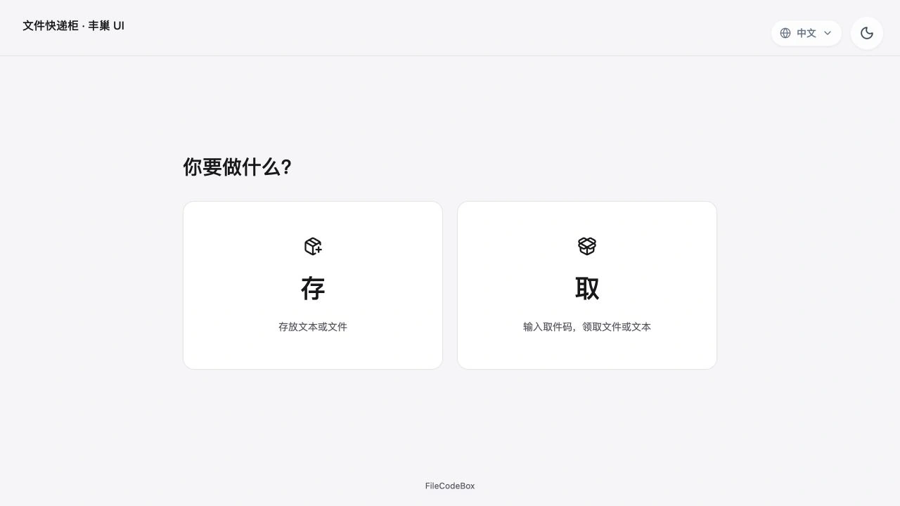
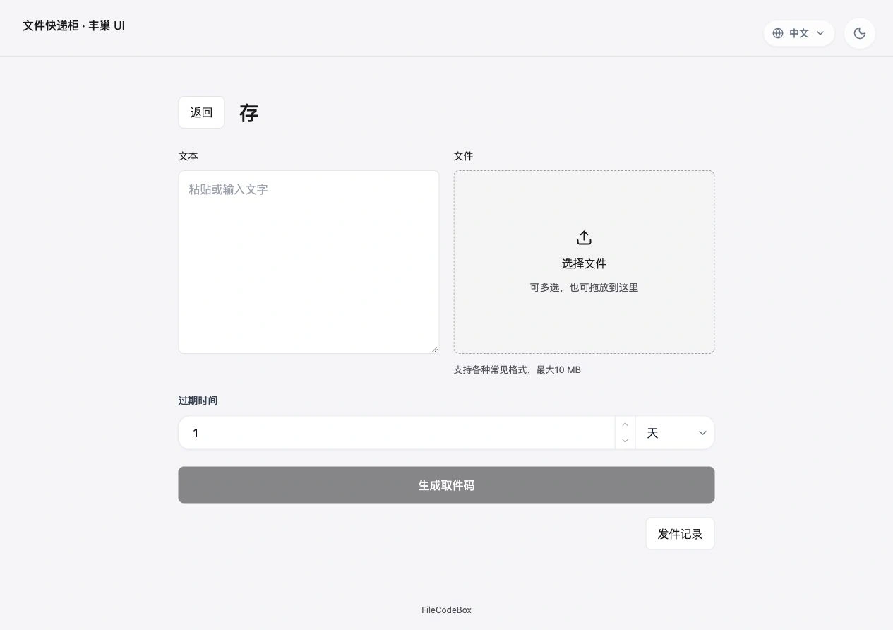
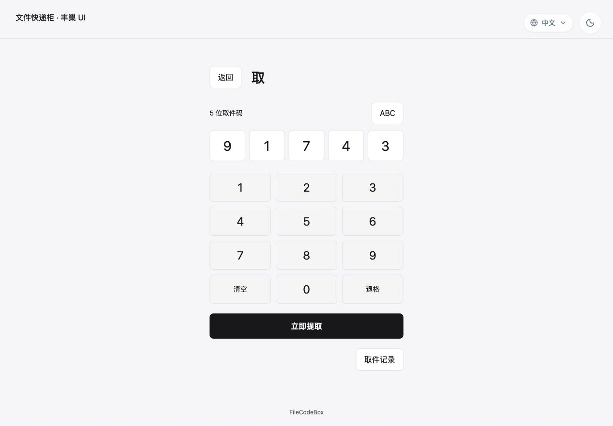

# FileCodeBox · 丰巢快递柜 UI

本仓库是 [vastsa/FileCodeBox](https://github.com/vastsa/FileCodeBox) 的 fork，将公开存取页面更新为 **丰巢快递柜风格的 UI**：像使用快递柜一样，选择「存」分享文件或文本，选择「取」输入取件码领取内容。

[本 fork](https://github.com/MrLoading/FileCodeBox) · [上游项目](https://github.com/vastsa/FileCodeBox) · [English](./readme_en.md)



## 本 fork 的更新

- 首页提供同等大小的「存」「取」入口，存取操作各有独立页面。
- 存件支持文本、文件、拖拽和粘贴；输入文本或选择文件后，对应区域自动展开，多文件自动打包为 ZIP。
- 取件支持屏幕数字键盘、键盘输入和粘贴，点击「立即提取」后领取内容；旧取件链接仍可使用。
- 支持中英文、深浅色切换，保留原有后台管理功能，以及官方 2023 / 2024 主题。

## 存取步骤

### 存：分享文本或文件

首页点击「存」，输入文本或选择、拖入文件，设置过期时间后点击「生成取件码」。发送成功后，将取件码或取件链接分享给对方。



### 取：输入取件码领取

首页点击「取」，通过屏幕数字键盘、键盘或粘贴输入取件码，再点击「立即提取」下载文件或查看文本。



截图来自本 fork 的实际界面，取件码为演示数据。

## Docker 部署

准备 Git、Docker 和 Docker Compose v2，在本 fork 的仓库根目录构建并启动：

```bash
git clone --branch master https://github.com/MrLoading/FileCodeBox.git
cd FileCodeBox
docker compose up -d --build
```

访问 `http://服务器IP:12345`，首次访问按向导设置管理员密码、上传限制和取件策略。新安装默认使用丰巢主题；后台入口为 `/#/admin`。

**本 fork 通过源码构建部署。** 仓库内的 Dockerfile 会编译 `frontend/`，在固定的官方 `lanol/filecodebox:2.8.5` 后端镜像上加入丰巢主题，生成本地镜像 `filecodebox-fengchao:local`。宿主机无需安装 Node.js 或 Python，首次构建需要下载基础镜像和依赖。

`docker-compose.yml` 默认映射 `12345:12345`，使用命名卷 `fcb-data` 挂载到 `/app/data` 保存数据库、配置和文件。需要修改访问端口时，调整冒号左侧的宿主机端口。

### 从已有部署升级

先备份数据，并让新容器继续挂载原来的 `/app/data`。默认 Compose 会创建当前项目自己的命名卷，不会自动读取旧容器的数据。

- **原先使用宿主机目录**：将服务中的 `fcb-data:/app/data:rw` 改为原目录，例如 `/原数据目录:/app/data:rw`。
- **原先使用 Docker 命名卷**：保持服务中的挂载不变，将文件末尾的卷配置改为以下内容，填入原卷的完整名称：

```yaml
volumes:
  fcb-data:
    external: true
    name: 你的现有数据卷名
```

原容器占用 `12345` 端口时，先停止原容器，再启动本 fork。已有安装会保留原主题选择；登录 `/#/admin`，在「系统设置 → 界面主题」选择 **Fengchao** 并保存。

### 后续更新与常用命令

```bash
git pull --ff-only
docker compose up -d --build
```

查看日志用 `docker compose logs -f --tail=100`，停止服务用 `docker compose down`。保留数据时不要添加 `-v`。

## Fork 来源与致谢

- 后端上游：[vastsa/FileCodeBox](https://github.com/vastsa/FileCodeBox)，本 fork 的 Docker 构建基于官方 `2.8.5` 镜像。
- 前端来源：[vastsa/FileCodeBoxFronted](https://github.com/vastsa/FileCodeBoxFronted)，导入版本为 `2d6173e0d4fe4d543479143842408abb50bd5f9b`。感谢 Lan 和原项目贡献者。
- 丰巢主题源码与开发说明：[frontend/README.md](./frontend/README.md)；完整前端来源记录：[frontend/UPSTREAM.md](./frontend/UPSTREAM.md)。
- 项目沿用 [LGPL-3.0 许可证](./LICENSE)。上游通用功能文档见 [FileCodeBox 文档](https://fcb-docs.aiuo.net/)。
