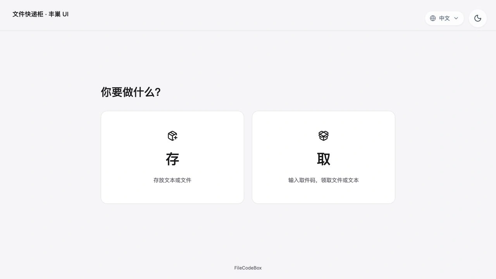
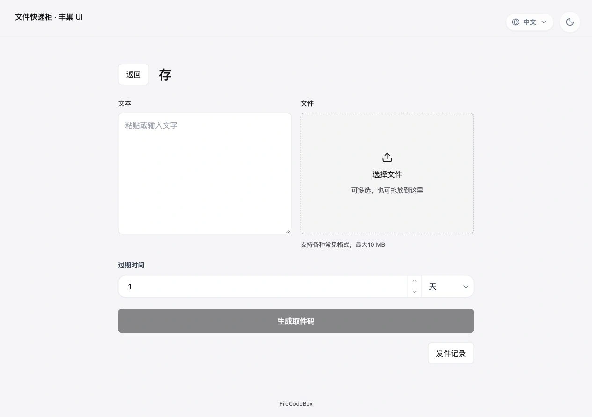
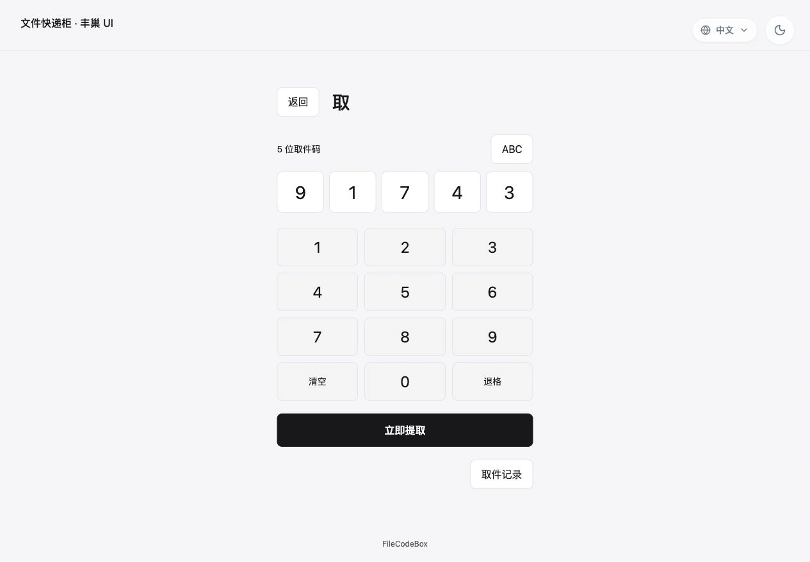

# FileCodeBox · Fengchao Locker UI

This is a fork of [vastsa/FileCodeBox](https://github.com/vastsa/FileCodeBox) with a **Fengchao parcel-locker-style UI**. Choose **Send** to share text or files, or **Receive** to retrieve them with a code.

[This fork](https://github.com/MrLoading/FileCodeBox) · [Upstream](https://github.com/vastsa/FileCodeBox) · [简体中文](./readme.md)



## Changes in this fork

- Separate Send and Receive pages with equally prominent home-page actions.
- Text and file inputs expand when used; multiple files are automatically packed into a ZIP.
- An on-screen number pad, keyboard input and paste for retrieval, followed by explicit confirmation. Existing retrieval links remain supported.
- Chinese and English, light and dark modes, existing administration features, and the official 2023 / 2024 themes.

## Send and Receive

### Send text or files

Choose **Send**, enter text or select/drop files, set an expiration, then generate a retrieval code. Share the code or retrieval link with the recipient.



### Receive with a code

Choose **Receive**, enter or paste the code using the number pad or keyboard, then confirm to download the file or view the text.



These three screenshots show the actual Chinese interface with demo data. The UI also supports English.

## Docker deployment

Install Git, Docker and Docker Compose v2, then build and start from this fork's repository root:

```bash
git clone --branch master https://github.com/MrLoading/FileCodeBox.git
cd FileCodeBox
docker compose up -d --build
```

Open `http://SERVER_IP:12345` and complete the first-run setup, including an administrator password. New installations use Fengchao by default. Administration is available at `/#/admin`.

**Build this fork from source.** The repository's Dockerfile compiles `frontend/` and adds Fengchao to the pinned official `lanol/filecodebox:2.8.5` backend image. Compose builds the local image `filecodebox-fengchao:local`, publishes port `12345`, and mounts the `fcb-data` named volume at `/app/data`. Node.js and Python are not required on the host; the first build downloads base images and dependencies. To change the public port, edit the left side of `12345:12345`.

### Upgrading an existing installation

Back up your data and reuse the existing `/app/data` mount. The default Compose file creates a volume for the current project and does not automatically import another container's data.

- For an existing host directory, replace the service's `fcb-data:/app/data:rw` mount with `/path/to/existing/data:/app/data:rw`.
- For an existing Docker volume, keep the service mount and replace the top-level volume definition at the end of `docker-compose.yml`:

```yaml
volumes:
  fcb-data:
    external: true
    name: your-existing-volume-name
```

Stop the previous container if it occupies port `12345`. Existing installations retain their theme selection: log in at `/#/admin`, select **Fengchao** under **System Settings → Theme Selection**, and save.

### Subsequent updates

```bash
git pull --ff-only
docker compose up -d --build
```

Use `docker compose logs -f --tail=100` for logs and `docker compose down` to stop. Omit `-v` to keep the data volume.

## Fork attribution

- Backend: [vastsa/FileCodeBox](https://github.com/vastsa/FileCodeBox); the Docker build uses the official `2.8.5` image.
- Frontend: [vastsa/FileCodeBoxFronted](https://github.com/vastsa/FileCodeBoxFronted), imported at `2d6173e0d4fe4d543479143842408abb50bd5f9b`. Thanks to Lan and the original contributors.
- Fengchao source and development instructions: [frontend/README.md](./frontend/README.md). Source attribution: [frontend/UPSTREAM.md](./frontend/UPSTREAM.md).
- License: [LGPL-3.0](./LICENSE). General upstream documentation: [FileCodeBox docs](https://fcb-docs.aiuo.net/en/).
